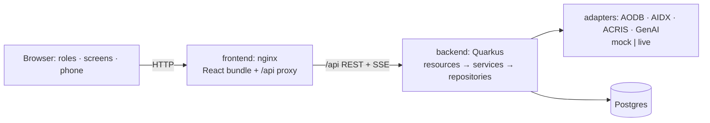

# Airport Retail Media Platform

A locally runnable proof of concept for ads and promotions on airport screens, timed to live flight and
passenger-flow data. Every decision is scored, explained ("Why this ad?") and logged so it can be reproduced. The
airport, airlines and brands are fictional: Amberport International (IATA `AMP`).

**Playground:** <http://142.93.232.242> · **API docs:** <http://142.93.232.242/api/docs> ·
**OpenAPI:** <http://142.93.232.242/api/openapi> ([snapshot](docs/openapi.yaml))

## Quick start

Requires Docker only (no JDK, Maven or Node on the host):

```bash
docker compose up --build
```

Open <http://localhost:8088>. The first start builds both images and seeds a full airport-day: 900 flights,
180 screens, 40 outlets, campaigns and 30 days of history. Later starts reuse the database volume.

| What | Where |
|---|---|
| App (all roles) | `http://localhost:8088` |
| A passenger screen | `http://localhost:8088/screen/{id}` (pick one under *Passenger Screen*) |
| Promo claim page (phone) | opened from the screen's QR, `/claim/{code}` |
| Swagger UI / OpenAPI | `/api/docs`, `/api/openapi` |

For QR codes to open on a phone, set the laptop's LAN address in *Passenger Screen → QR LAN address*.

### Developing

```bash
cd backend && ./mvnw quarkus:dev     # :8080, throwaway Postgres via Dev Services (Docker)
cd frontend && npm install && npm run dev   # :5173, proxies /api to :8080
```

Tests: `cd backend && ./mvnw test` (Testcontainers Postgres). Frontend: `npm run build` (type-check + bundle) and
`npm run lint`.

## A five-minute demo

1. **Split-screen demo** (header) shows a passenger screen beside any role dashboard, both driven by one clock.
2. Control bar → **→ 14:10 (Gate 42)** → **Play**. At SCR-GATE42 the duty-free campaign wins the documented
   Gate 42 worked example. **Why this ad?** shows the crowd profile, the top candidates and the winning rules.
3. **Delay flight**: the delay flows through the AIDX adapter. Within ~2 s the screen's departure board, the
   retailer's passenger flow and the admin KPIs change, and long delays create a co-funded goodwill voucher.
4. Scan the QR (or open the claim link): the phone page claims the single-use code, and the retailer funnel
   updates live.
5. **EN | ES** switches every role, the screen's ad copy and the claim page to Spanish.

## Roles

No login. Roles are personas switched in the header.

- **Platform Admin** (dark control-room theme): live KPIs, terminal map with screen status and passenger heat,
  auto-raised incidents, master data.
- **Retailer**: live funnel (impressions → scans → redemptions), passenger flow near its stores, campaign
  builder with a live audience-match preview, history, promo codes, creative library, GenAI creative assistant,
  best slots for tomorrow.
- **Media Manager**: approval queue (only approved campaigns reach the pipeline), inventory calendar, yield
  pricing and forecast, advertiser overview.
- **Airline Representative**: its flights, sponsored gate content, automatic delay vouchers.
- **Passenger Screen**: any of the 180 screens at full size, with a FIDS strip, the winning ad, QR and countdown.

## Architecture



React (Vite) talks to a layered Quarkus backend through one origin. Server-Sent Events (`/api/stream`) carry the
server-authoritative simulation clock and every domain event, so all views stay in lock-step. Feeds come in
through adapters that translate wire formats (AODB CSV, AIDX XML, ACRIS NGSI-LD) into one canonical model.
Diagrams, the decision pipeline and the claim flow are in [docs/architecture.md](docs/architecture.md).

### Why Java and Quarkus

- **Strongest language, tightest deadline.** The build was one developer in ~30–36 hours. Java was the fastest
  route to correct code, and that mattered most where the spec demands auditability: the scoring pipeline,
  expiry and caps are pure, test-first Java with records.
- **Quarkus specifically.** It starts fast and runs lean, which fits a 2 GB droplet. Constructor injection keeps
  logic testable without a container. Dev Services and Testcontainers give a real Postgres with zero setup.
  Hibernate/Panache and Flyway own the schema, and Mutiny `Multi` makes the SSE stream a few lines.
  `quarkus-langchain4j` makes the LLM a config value with an offline mock as the default.
- **Trade-off accepted.** Node or Python would be a more typical choice for a demo-heavy web app. We traded that
  familiarity for the developer's depth in Java (ADR 0002).

## Adapters: mock to live

Each feed is a **Source** (mock | live) plus a shared **Translator**, switched by one value:
`APP_FLIGHT_SOURCE`, `APP_AIDX_SOURCE`, `APP_ACRIS_SOURCE` (`mock` | `live`) and
`APP_CREATIVE_ASSISTANT_PROVIDER` (`mock` | `llm`). See [docs/adapter-guide.md](docs/adapter-guide.md).

## Configuration

Copy `.env.example` to `.env` to override. `HTTP_PORT` defaults to 8088 (80 on the droplet), and the adapter and
LLM settings are above. Backend tuning (seed size, decision cadence, thresholds) lives in
`backend/src/main/resources/application.properties`.

**White-label theming:** `frontend/src/brand.ts` holds the product name, host-airport name, logo and colours, and
is the only place a re-brand touches (plus `frontend/public/favicon.svg`). **Languages:** English and Spanish
(`frontend/src/i18n/messages.ts`). Ad copy is stored per creative and language, and is never machine-translated.

## Deployment

The droplet runs the same `docker-compose.yml`. Only `.env` differs (`HTTP_PORT=80`). To redeploy after pushing
to `main`, run one command:

```bash
ssh root@142.93.232.242 /root/topcoder-airport-media-platform/scripts/redeploy.sh
```

It pulls, rebuilds what changed, restarts, and waits until the API answers through nginx. Containers restart on
reboot, and the database volume keeps the seeded day between deploys.

First-time setup on a fresh Ubuntu droplet: install Docker Engine with the compose plugin, add a 2 GB swap file
(the backend image builds with Maven in 2 GB of RAM), clone the repo, run `echo HTTP_PORT=80 > .env`, then run
`scripts/redeploy.sh`.

## Documentation

- [docs/architecture.md](docs/architecture.md): system view, decision pipeline, claim sequence
- [docs/adapter-guide.md](docs/adapter-guide.md): swapping a mock feed for a live one
- [docs/openapi.yaml](docs/openapi.yaml): REST API spec (the live one is at `/api/openapi`)
- [docs/adr/](docs/adr/): architecture decision records
- [CONTEXT.md](CONTEXT.md): domain language (Demo Spine, Peripheral Role, canonical entities)
