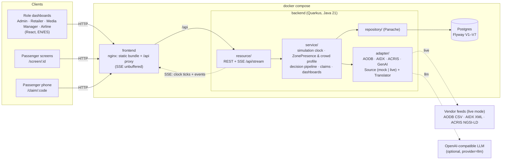
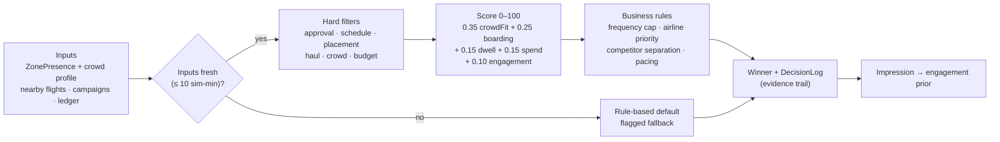
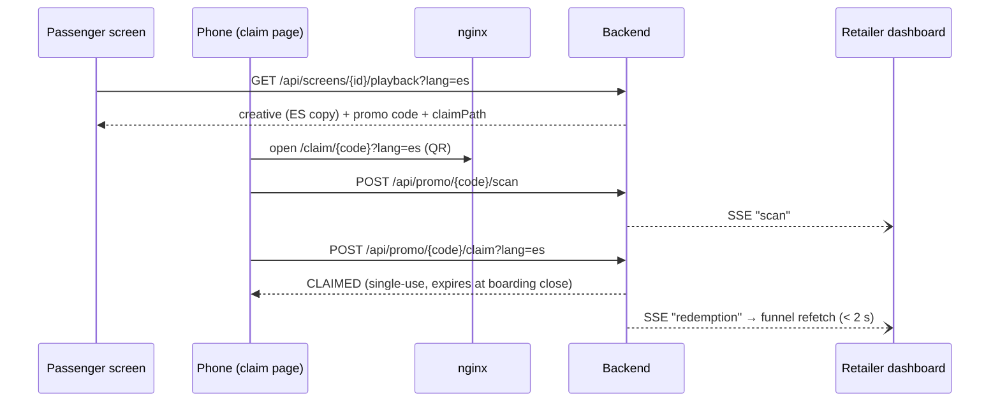

# Architecture

One Docker Compose stack: Postgres, a Quarkus backend, and an nginx container that serves the React bundle and
proxies `/api` (REST + Server-Sent Events) to the backend, so the browser only ever talks to one origin. The same
stack runs on a laptop and on the DigitalOcean droplet (ADR 0002).

## System view



- **Canonical model.** Services and resources only see canonical entities (`domain/entity`: Flight, Zone,
  Campaign, Creative…). Each adapter turns its own wire format into those entities; see the
  [adapter guide](adapter-guide.md).
- **One clock, one stream.** The simulation clock is server-authoritative. `GET /api/stream` merges clock ticks
  and domain events (delays, gate changes, screen status, scans, redemptions, incidents, goodwill vouchers), so
  every view, including the split-screen demo, moves in lock-step at 1×, 10× or 60×.
- **No authentication.** Roles are UI personas the header switches between. There are no sessions or tokens.

## Decision pipeline

Per screen, per slot. It is a pure function of a logged `DecisionInputs` record, so any score can be reproduced
from the decision log (ADR 0004 has the formula and the Gate 42 worked example).



The passenger screen renders the winner's creative in the viewer's language (a stored translation or the
original, never machine-translated), its promo QR, and a "Why this ad?" overlay read straight from the log.

## Request flow: a QR claim



## Backend layout

```
backend/src/main/java/com/airportmedia/platform/
  common/      enums, exceptions + ExceptionMappers (one ErrorResponse shape), reference data
  config/
  domain/      entity/ (canonical model), model/{input,mapper,output,validation}
  adapter/     aodb/ aidx/ acris/ genai/ — Source (mock|live) + Translator per feed
  resource/    REST + SSE endpoints (all under /api)
  repository/  Panache repositories
  service/     simulation, presence, decision/, admin/, media/, airline/, assistant/
```

Decisions behind this shape are in [`docs/adr/`](adr/): depth-first scope (0001), stack and deployment (0002),
injected events through the adapters (0003), decision scoring (0004).
